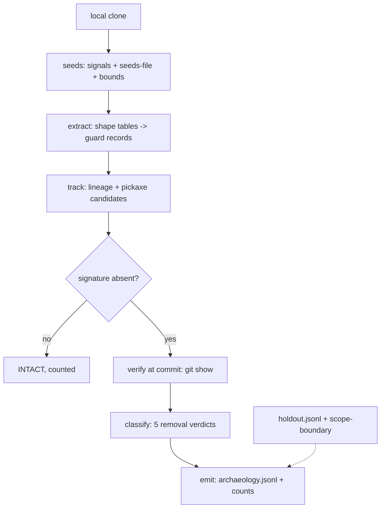
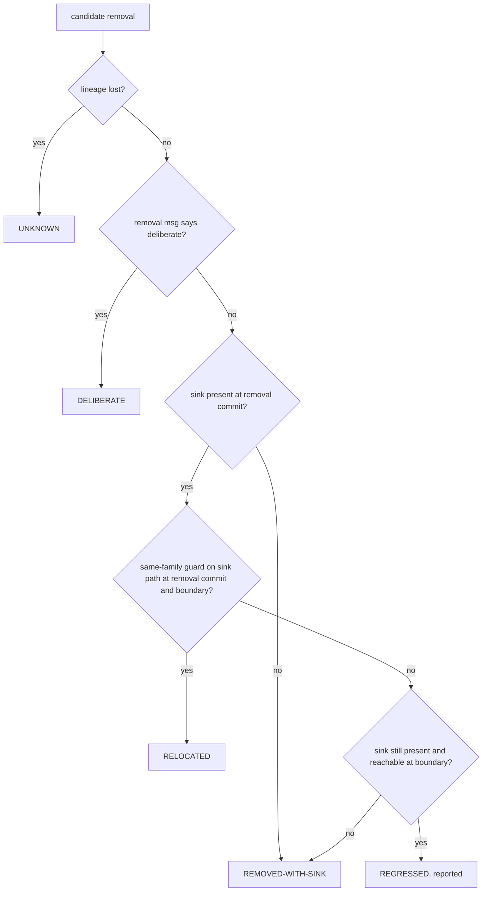

# Guard Archaeology v1 Implementation - Plan

## Goal Capsule

- **Objective:** An operator runs `archaeology <repo-root>` against a local clone and gets a deterministic, siblings-shaped list of REGRESSED candidates — sites where a guard added by a security-relevant commit was later removed while its sink still lives at HEAD — ready for kill-before-debug to drain.
- **Means:** Subprocessed-git pipeline over seed commits: extract guard hunks from security-signaled diffs as normalized text signatures, pickaxe-track each signature through the file's rename lineage to find the first commit where it is absent, classify the removal into the spec's five removal verdicts, and emit JSONL (KTD1, KTD2, KTD3, KTD4).
- **Authority:** SPEC.md is the origin document and owns product behavior; where this plan and SPEC.md disagree on mechanics (JSONL vs md primary output, RELOCATED equivalence granularity, caller-boundary detection), the plan's KTDs state the resolution explicitly.
- **Stop conditions:** the validation gate's known-answer case misses, or the drainability run produces a queue too large to hand-drain; any requirement proves infeasible without widening scope the spec forbids.
- **Execution profile:** single-package build, one branch, tests alongside units.
- **Tail ownership:** commits land locally; no push, no PR (user-directed this run).

---

## Product Contract

### Summary

Build the guard-archaeology v1 CLI specified in SPEC.md: a deterministic, network-free, four-language analyzer that finds security guards a codebase added and later silently lost. Ships seed collection, shape-table extraction, pickaxe forward tracking, the five-class removal classifier (plus the INTACT tracking outcome), and `.clawpatch/archaeology.jsonl` output, plus planted-history fixtures covering every terminal class and a two-leg validation gate.

### Problem Frame

Patch history tools ask what got fixed; SPEC.md frames the complementary question — what unfixed itself. A guard added in a security fix and removed by a later refactor is a real paid finding class, and nothing in the stack greps history for removed defenses. The tool's output is candidates for kill-before-debug, not findings: it inherits the stack's discipline (deterministic, silence over noise, evidence-shaped rows) from the sibling tools Holdout and dyetrace. Motivation, pipeline placement, and out-of-scope live in SPEC.md sections Purpose, Core discipline, and Out of scope; this plan does not restate them.

### Requirements

**Seeding**

- R1. Collect seed commits from the target repo's local history: commits referenced by an operator-supplied advisory fix-commit list (`--seeds-file`), commits whose message carries security signals (CVE/GHSA ids, or security vocabulary paired with a fix verb), and commits in security-tagged refs when the repo marks them. All other history is ignored as a guard origin (SPEC.md Seed).
- R2. History bounds: `--since`/`--until <rev>` bound the tracked window — **rev bounds, not git's same-named date flags**: `--until U` restricts enumeration to ancestors of U and `--since S` bounds the range as `S..U` ancestry, implemented through rev arguments (`git rev-list`/`git log <until> [^<since>]`-style), never passed through to git's `--since`/`--until`. `--until` is required by the validation gate, which replays history "as of just before the second fix" (SPEC.md Validation gate); without it a REGRESSED verdict cannot be demonstrated on a repo where the guard was later re-added.

**Extraction**

- R3. From each seed commit's diff, extract added guard hunks in three shapes: conditional rejection (new condition guarding early return/raise/revert/error-path before a sink in the same function), added validation/sanitizer/escaping call on the sink's data path, and added constant (size cap, allowlist, limit) consulted before the sink (SPEC.md Extract).
- R4. Record per guard: guard class (SPEC.md Definitions vocabulary — this plan's "guard family" is the same taxonomy, one term everywhere downstream), normalized signature (KTD9), raw added guard text (KTD3's candidacy input), sink `file:function`, seed commit SHA, advisory ID when the seed came from `--seeds-file`.
- R5. Shape tables cover Go, Rust, Python, TypeScript/JavaScript (SPEC.md Guard classifier v1). Anything the tables cannot classify is not extracted — precision over recall is a spec mandate, not a tuning choice.

**Tracking and classification**

- R6. Track each extracted guard from seed commit to HEAD-or-`--until`: locate the normalized signature through subsequent history (pickaxe search) across the file's rename lineage. A guard surviving to the boundary is closed as INTACT — counted, never reported.
- R7. The first commit where the signature is absent from the file's reachable code while file and function lineage continue is the candidate removal commit.
- R8. Classify each candidate removal into exactly one of the five removal verdicts: REGRESSED, RELOCATED, REMOVED-WITH-SINK, DELIBERATE, UNKNOWN (SPEC.md Removal classification). INTACT is assigned by tracking (R6) and never reaches the classifier.
- R9. REGRESSED requires proven absence of the same guard family on the whole sink path — function plus bounded caller chain to `--caller-depth` (default 2, the Holdout rule the spec cites) — at both the removal commit and the boundary commit. Unprovable is UNKNOWN, never REGRESSED.
- R10. DELIBERATE fires when the removal commit's message — subject, body, and merge-commit text including its constituent commits' messages, which is the only "linked-PR language" a local clone can carry — states the removal or revert intentionally (revert of the seed commit, explicit removal wording). Closed as a candidate, listed separately in the run summary.
- R11. REMOVED-WITH-SINK fires when the sink itself was deleted or the feature removed wholesale. RELOCATED fires per KTD4's family-equivalence rule. UNKNOWN fires on lost lineage (history rewrite, squash boundary, delete-recreate).

**Emission**

- R12. Emit `.clawpatch/archaeology.jsonl` next to the target's scope note: one `type:"candidate"` row per REGRESSED carrying guard class, sink file:function at boundary, missing signature, seed {SHA, advisory id}, removal {SHA, subject}, unguarded sink excerpt at boundary, exposure bucket, and a `siblings` field in the drain format (KTD5). Stable ids and stable order (KTD10).
- R13. Run header carries counts by class — tracked, INTACT, REGRESSED, RELOCATED, REMOVED-WITH-SINK, DELIBERATE, UNKNOWN — so an empty candidate list reads as checked, not skipped. Per-file/per-commit failures emit a `type:"error"` row and degrade the affected guard's verdict to UNKNOWN; they never abort the run.
- R14. Exposure per row: `untrusted | internal | unknown` resolved from `<target>/.clawpatch/scope-boundary.md` auto-read or `--exposure-file` JSON map, mirroring Holdout's resolution order. `unknown` is its own bucket, never assumed.
- R15. When `<target>/.clawpatch/holdout.jsonl` exists, candidates whose sink (path + function) matches a holdout row carry a `holdout` cross-reference field; a site that is both a holdout outlier and an archaeology REGRESSED is the strongest candidate the stack produces (SPEC.md Integration).
- R16. `--also-md` writes the same rows as markdown beside the JSONL for human drain.

**Determinism and discipline**

- R17. No model judgment anywhere in the verdict path; no network access beyond the clone; no target code is ever executed (SPEC.md Core discipline, Integration).
- R18. Identical input history produces a byte-identical candidates file: stable sort by removal commit date then sink path, stable row ids (KTD10). A re-run on the same clone diffs clean.
- R19. CLI: `archaeology <repo-root> [--out <path>] [--seeds-file <path>] [--since <rev>] [--until <rev>] [--caller-depth 2] [--exposure-file <path>] [--also-md]`; `--out` defaults to `<repo-root>/.clawpatch/archaeology.jsonl` (the path R12 pins); exit 0 on success including the zero-candidate case; nonzero on unreadable root, bad flag, or output-write failure; stdout prints a one-line counts summary `seeds=N tracked=T intact=I regressed=X relocated=L removed_with_sink=S deliberate=D unknown=U`.

**Testing and gate**

- R20. Fixture repos with planted histories cover every verdict class — guard added then intact, relocated, removed-with-sink, deliberate-revert, silently removed — plus a lost-lineage case, before any real target is run (SPEC.md Build notes).
- R21. Validation gate before the tool is trusted on live targets: a known-answer repo with a documented fix regression, run as of just before the second fix via `--until`, must surface the lost guard as a REGRESSED candidate with true seed and removal commits; and a large mature repo with no known regression must produce a hand-drainable REGRESSED count (SPEC.md Validation gate). Results recorded in `docs/gate-results.md`.

### Key Decisions

- KD1. **Candidates, never findings.** SPEC.md's framing rule; governs every output surface's wording — rows are drained, not filed. Governs R12, R16.
- KD2. **Fail quiet over loud.** A weak evidence chain closes a candidate rather than flagging it; UNKNOWN is a close, not a report. Governs R9, R11, R13.
- KD3. **Three-link evidence or no ship.** Every reported candidate carries seed commit, removal commit, and current sink code. Governs R12.
- KD4. **Deterministic.** Mechanical signals only — diff shapes, pickaxe, commit metadata; re-runs are diffable. Governs R17, R18.
- Product Contract preservation note: SPEC.md is a spec, not a unified plan; its decisions are carried forward here as Rs/KDs — changed: none; amended mechanics are recorded as KTD1, KTD3, KTD4, KTD5, KTD7.

### Success Criteria

- Gate leg 1: the known-answer repo surfaces the lost guard as a REGRESSED candidate with the true seed commit and a removal commit in the true range, run under `--until`.
- Gate leg 2: the drainability repo's REGRESSED count is small enough to inspect by hand; `docs/gate-results.md` records both legs.
- `archaeology` on a planted fixture repo produces byte-identical JSONL across runs (KD4).
- Fixture coverage exercises every verdict class, including the negative classes (a RELOCATED fixture must not surface as a candidate).

### Scope Boundaries

SPEC.md's "Out of scope for v1" list is adopted verbatim: guards never in git history (first commit is the floor), non-source defenses (config, infra, WAF), merge-conflict resolution analysis beyond removal classification, and automated PoC generation or submission.

#### Deferred to Follow-Up Work

- Structural (AST-level) signatures for a single language, if the gate shows text normalization losing a true guard to reformatting (KTD1's revisit condition).
- Live advisory-feed fetching (GHSA/CVE lookup); v1 takes operator-supplied `--seeds-file` only.
- Sweep-corpus sync for shape tables; v1 hand-maintains `shapes.py` the way Holdout hand-maintains `families.py`.
- Deeper caller-boundary precision beyond KTD7's lexical approach (e.g., a ctags/tree-sitter provider).

### Sources

- SPEC.md — origin spec (pipeline, verdict classes, output contract, gate).
- Holdout — sibling conventions: JSONL drain rows, depth-2 caller rule, exposure resolution, packaging, gate recording (`/home/ubuntu/projects/holdout`: SPEC.md, `src/holdout/{emit,exposure,callers,families}.py`, `docs/plans/2026-10-21-2141-feat-holdout-v1-implementation-plan.md`, `docs/gate-results.md`).
- dyetrace — sibling packaging/CLI conventions (`/home/ubuntu/projects/dyetrace`).
- `.clawpatch/` layout and findings schema — observed on `wt-openbot-clawpatch` worktree.
- Live pickaxe experiment this session — `-S`/`-G` over a glob pathspec surfaces add and removal commits across a rename; `-M`/`--follow` carry lineage.
- Operator's vuln-triage campaign note (signet memory) — target-activity pre-check behind KTD12 (`pushed_at`/`archived` before cloning; 4 of 10 long-tail candidates were dead repos).

---

## Planning Contract

### Key Technical Decisions

- KTD1. **Guard signatures are normalized text, not AST.** Identifiers and literals abstract to shape-class tokens at the statement level (a multi-line guard normalizes to one signature, so line-splitting reflows do not break it); tracked via pickaxe. (session-settled: user-directed — delegated to ce-pov this session, chosen over per-language AST signatures: the spec's own definition describes text-level abstraction, AST needs four parsers and breaks the zero-dependency convention Holdout pinned, and the residual brittleness is bounded by the verify-at-commit step in KTD3.)
- KTD2. **All four ecosystems in v1, thin tables.** Go, Rust, Python, TS/JS shape tables per SPEC.md's explicit v1 scoping; each starts small and grows — precision-over-recall licenses thinness. Feasible because KTD1 makes shapes diff-text patterns, not parsers. (session-settled: user-directed — delegated to ce-pov, chosen over Python-first: unlike Holdout's spec, this spec scopes v1 to four languages without hedging.)
- KTD3. **Tracking = pickaxe for candidacy, `git show` for verdict.** Candidacy never queries the token-abstracted signature — those tokens do not appear in any source blob, so `-S<normalized-sig>` matches nothing (reviewer-verified defect in an earlier draft of this decision). Instead, `shapes.py` compiles each normalized signature to a `-G` regex (signature skeleton with identifier/literal tokens expanded to character classes; a multi-line signature anchors on its first line's skeleton) and `git log --full-history -G<regex>` over the rename-following path lineage (built via `-M`/`--follow`) yields candidate removal commits — `--full-history` so a removal entering through a merged side branch is not hidden by TREESAME simplification. The guard record carries both the raw added text and the normalized signature; the verdict is made only by materializing the file at each candidate commit (`git show`) and re-normalizing present guard statements to test signature absence — never by diff-shape inference alone. A cleared candidate (reflow, rename, in-function move) is recorded as a mutation event and candidacy scanning resumes at the next hit until verified absence or the boundary. Verified live: `-G`/`-S` over a glob pathspec surfaces both add and removal commits across a `git mv`. (session-settled: user-directed — delegated to ce-pov, chosen over a sequential commit-walk of full history and over `git log -L :func:` function-range tracking: same answer at O(seed-affected paths) instead of O(commits), and the signature — not the function range — is the unit of truth.)
- KTD4. **RELOCATED tests family-level equivalence, not signature identity.** RELOCATED fires when the removal commit (or its merge range when identifiable) puts *any* shape-table guard of the same family onto the sink path AND an equivalent guard still covers the path at the boundary — a strengthened replacement must not report as loss, but a replacement that itself died before the boundary leaves the sink unguarded now, which is REGRESSED's definition (a same-family guard unrelated to the relocation can close the case; that edge is accepted under the fail-quiet bias). REGRESSED requires the R9 proven-absence bar; a replaced-with-different-shape guard the tables cannot match lands UNKNOWN. (session-settled: user-directed — delegated to ce-pov, chosen over same-signature-moved detection: signature-identity would misclassify strengthened guards as REGRESSED or UNKNOWN noise.)
- KTD5. **JSONL primary, `--also-md` optional.** `.clawpatch/archaeology.jsonl` is the drain format sibling-triage consumes; `.md` renders the same rows for humans. Mirrors Holdout's resolution of the identical spec ambiguity. (session-settled: user-directed — delegated to ce-pov, chosen over SPEC.md's `.md`-first wording: JSONL is the machine drain; the md is generated from it, never a second authoring path.)
- KTD6. **Packaging mirrors Holdout/dyetrace:** hatchling + `src/archaeology/` layout, `[project.scripts] archaeology = "archaeology.cli:main"`, `main(argv=None)` with injectable seams, flat `tests/test_<module>.py`, fixtures under `tests/fixtures/`. Zero runtime deps; `pytest` the only dev dep. `requires-python >=3.10` mirrors the siblings.
- KTD7. **Lexical caller boundaries over a commit-scoped corpus, UNKNOWN on doubt.** The R9 caller-chain check runs against the source tree materialized at the removal commit and again at the boundary commit: `git log`'s sibling `git ls-tree -r --name-only <sha>` enumerates paths, `git grep -l <func-name> <sha>` narrows the caller-candidate file set without materializing the whole tree, and `git show <sha>:<path>` reads each. It locates enclosing functions and call sites lexically per language (declaration patterns, indentation/brace scoping, name binding to the sink argument), bounded to `--caller-depth` (default 2). A function with zero resolvable in-repo callers is provable on its own scope — the empty chain cannot hide a guard — so exported sinks can still reach REGRESSED. But when callers exist and the boundary or binding cannot be established, the check answers "cannot prove" — which drives UNKNOWN, never REGRESSED. This is the deliberately conservative half of KTD1: imprecision degrades coverage, not trust.
- KTD8. **Fixture histories are built by a test helper, not checked in.** `tests/` carries a `make_repo` builder that constructs a git repo from a declarative commit script (file content per commit, message, optional `git mv`), so every verdict class gets a planted history without vendoring binary git fixtures. Determinism pins the full commit environment — `GIT_AUTHOR_DATE`/`GIT_COMMITTER_DATE` plus `GIT_AUTHOR_NAME`/`GIT_AUTHOR_EMAIL`/`GIT_COMMITTER_NAME`/`GIT_COMMITTER_EMAIL`, a fixed `init.defaultBranch`, and `--object-format=sha1` — so fixture SHAs are identical across machines regardless of ambient gitconfig.
- KTD9. **Signature scheme: shape-class skeleton + operand abstraction.** The normalized form keeps the guard's structural skeleton (condition operator, rejection action, call family, comparison direction) and abstracts identifier names and literal values to tokens. Two guards that differ only in names share a signature — which is what lets pickaxe find the same guard after a variable rename.
- KTD10. **Determinism mechanics.** Row id = short sha of `(guard-family, sink path, sink function, seed SHA)`; output sort = removal commit date, then sink path, then seed SHA, then row id as the final tiebreak (same-commit removals of sibling guards on one sink path must not depend on enumeration order); `--out` written atomically (temp + rename); all commit enumeration sorted by commit date then SHA so ties cannot reorder output.
- KTD11. **Exposure mirrors Holdout's provisional shape.** `--exposure-file` is a JSON map `"path:function" -> bucket`; scope-boundary auto-read accepts the `TAINT: yes` line subset pinned by `tests/fixtures/scope-boundary.md`; malformed or oversized input warns and is ignored, never crashes or partially applies (the file is untrusted input when the target is third-party code). Auto-read files under `<target>/.clawpatch/` — scope-boundary.md and holdout.jsonl alike — are realpath-confined to the target root exactly as `src/holdout/exposure.py` does it: a symlink escaping the root warns and is ignored.
- KTD12. **Gate targets pinned by SHA, enforced, and activity-checked.** Known-answer and drainability repos are pinned to explicit SHAs in `docs/gate-results.md`, and each leg asserts `git rev-parse HEAD` equals its pin and the tree is clean before running — an edited tree makes the gate fail for the wrong reason, and a pin without the check is decorative. Activity is checked before selection — per the operator's recorded vuln-triage campaign lesson, `gh api repos/{owner}/{repo}` `pushed_at`/`archived` before cloning; stale or archived targets are replaced, not rationalized.

### High-Level Technical Design



Removal classification decision order (per candidate removal):



### Output Structure

```text
guard-archaeology/
  pyproject.toml
  README.md
  SPEC.md                 # exists
  src/archaeology/
    __init__.py
    __main__.py
    cli.py                # args, orchestration, summary line
    gitlog.py             # subprocessed git: log/show/diff-parse/pickaxe/lineage
    seeds.py              # seed collection (signals, seeds-file, bounds)
    shapes.py             # per-language shape tables + signature normalization
    extract.py            # seed diffs -> guard records
    track.py              # lineage + pickaxe + verify-at-commit
    callers.py            # lexical bounded caller-chain presence check
    classify.py           # five-verdict removal classifier
    emit.py               # JSONL + optional MD, atomic writes, exposure join
    exposure.py           # scope-boundary/--exposure-file resolution
  tests/
    conftest.py           # make_repo fixture-history builder
    fixtures/scope-boundary.md
    test_*.py             # per-module
  docs/gate-results.md    # written by the gate unit
```

---

## Implementation Units

### U1. Package scaffold, CLI skeleton, git plumbing

**Goal:** Installable zero-dep package with the full flag surface and a subprocessed-git layer every later unit builds on; test-side `make_repo` builder for planted histories.

**Requirements:** R17, R18, R19, R20.

**Dependencies:** none.

**Files:** `pyproject.toml`, `README.md` (usage only), `src/archaeology/{__init__,__main__,cli,gitlog}.py`, `tests/conftest.py`, `tests/test_gitlog.py`, `tests/test_cli.py`.

**Approach:**
- `gitlog.py` owns every subprocess call: `git log` enumeration (with `--since`/`--until`-equivalent rev bounds), `git show <sha>:<path>` materialization, `git diff`/`log -p` parsing into per-file hunks, pickaxe `-S`/`-G` queries, and rename lineage via `--name-status -M` plus `--follow` fallback. Fixed env (`LC_ALL=C`, fixed committer dates irrelevant for reads) and a single error type carrying the failed invocation.
- `cli.py` parses the R19 flag surface and stubs the pipeline stages; `main(argv=None)` returns the exit code.
- `tests/conftest.py` provides `make_repo(spec)`: declarative commit list (files dict, message, optional rename ops) with pinned author/committer dates so fixture SHAs and orderings are deterministic.

**Patterns to follow:** Holdout `cli.py`/`__main__.py` shape and dyetrace packaging (`pyproject.toml` field-for-field conventions).

**Test scenarios:**
- `make_repo` builds a repo where `git log --oneline` order matches the declared commit order and SHAs are stable across rebuilds.
- `gitlog.log` enumerates commits honoring `--until`-equivalent bounds (a commit after the boundary is invisible).
- `gitlog.show_file(sha, path)` returns content at the sha; a path absent at that sha returns a typed "not found," not an exception.
- Diff parsing splits multi-file `git show` output into per-path hunks with added/removed lines attributed correctly (including the binary-diff and mode-change cases).
- Rename lineage: a file `git mv`'d across commits resolves to its full path chain via `-M`/`--follow`.
- CLI: bad flag exits nonzero with usage on stderr; unreadable repo root exits nonzero; `--help` exits 0.
- Error path: a malformed seeds file or a rev that does not resolve produces the typed error, not a traceback.

**Verification:** Package installs editable; `archaeology --help` works; gitlog tests pass against real `make_repo` repos (no mocks for git — the fixture is the contract).

### U2. Seed collection

**Goal:** The seed set: message-signal commits plus `--seeds-file` SHAs, deduplicated and deterministically ordered, bounded by R2's window.

**Requirements:** R1, R2, R18.

**Dependencies:** U1.

**Files:** `src/archaeology/seeds.py`, `tests/test_seeds.py`.

**Approach:**
- Signal table (extendable constant): CVE/GHSA id patterns; fix-verb + security-term pairs on the subject (`fix`, `close`, `patch`, `resolve`, `revert-of-fix` handled by classify, not here) × (`security`, `vuln`, `overflow`, `injection`, `bypass`, `traversal`, `auth`, `sanitize`, `escape`, `bounds`, `validate`).
- Security-tagged refs: when the repo marks them, the tag/branch's target commit plus the commits its release range introduced seed — never the ref's full ancestry (unbounded ancestry would collapse the seed noise gate). Best-effort per spec; absence is not an error.
- `--seeds-file`: newline-separated SHAs, optionally `SHA<space>ADVISORY-ID`; every listed SHA must resolve inside the bounded window or it is recorded as an unresolvable seed row, not dropped silently.
- Output: stable sort by commit date then SHA; dedup prefers the advisory-annotated record so `advisory_id` survives.

**Test scenarios:**
- A planted history with mixed messages yields exactly the security-signaled commits as seeds.
- CVE and GHSA strings in subjects seed; a commit saying only "improve validation messages" does not.
- `--seeds-file` SHA that never touched tracked paths still seeds (advisory authority over signals); an unresolvable SHA produces the explicit unresolvable record.
- `--until` excludes seeds after the boundary even when signaled.
- Re-run on the same repo yields identical seed order.

**Verification:** `archaeology <fixture> --seeds-file ...` prints the R19 summary line whose `seeds=` count matches the fixture's planted signal+seeds-file total, and the header's `tracked` count is consistent with it.

### U3. Guard extraction and signatures

**Goal:** From each seed diff, produce guard records: class, normalized signature, sink `file:function`, seed SHA, advisory id — four languages covered, unclassifiable input dropped.

**Requirements:** R3, R4, R5, R17.

**Dependencies:** U1, U2.

**Files:** `src/archaeology/shapes.py`, `src/archaeology/extract.py`, `tests/test_shapes.py`, `tests/test_extract.py`.

**Approach:**
- `shapes.py`: per-language tables keyed by extension (`.go`, `.rs`, `.py`, `.ts/.tsx/.js/.jsx/.mts/.cts`) with the three extraction shapes per language; sink vocabulary reuses the guard-class taxonomy (bounds/validation/allowlist/auth/escape/type-range/symlink) the spec shares with the sweep vocabulary.
- Signature normalization (KTD9): tokenize the added statement sequence; replace identifiers and literals with typed tokens (`ID`, `STR`, `NUM`, `CALL:<family>`); keep operator/keyword skeleton and comparison direction; collapse whitespace and line joins.
- Sink association (R3): the guard's sink is the first catalogued sink op reachable in the same function's text after the guard, else the enclosing function's immediate call targets per the bounded lexical walk (KTD7); no reachable sink in scope means not a guard for this tool — dropped, counted as an extraction skip.
- Language detection purely by path/extension at the diff level — a seed touching only unsupported extensions yields zero guards and counts toward "tracked: 0" honestly.

**Test scenarios:**
- Per language, each of the three shapes (conditional rejection, validation call, constant cap) extracts from a planted seed diff and produces the expected signature (golden signature strings in tests).
- A guard and its sink on the same added hunk associate correctly; a guard with no reachable sink is skipped and counted.
- Renamed identifiers produce identical signatures (`x` vs `user_input` guarding the same shape normalize equal); changed literals normalize equal.
- A guard split across three source lines and the same guard on one line produce one signature (statement-level normalization, KTD1).
- Mixed-language seed commits extract only supported-language guards; unsupported extensions contribute extraction-skip counts.
- Error path: a hunk that fails tokenization is skipped and counted, never raises.

**Verification:** Unit tests pin signature strings verbatim so normalization drift is visible in diffs, not silent.

### U4. Forward tracking

**Goal:** For each guard record, find INTACT or the candidate removal commit: pickaxe candidacy over the rename lineage, then verdict by file materialization.

**Requirements:** R6, R7, R17.

**Dependencies:** U1, U2, U3.

**Files:** `src/archaeology/track.py`, `tests/test_track.py`.

**Approach:**
- Build the file's path lineage first (`-M` on the file's own `git log`, `--follow` fallback), so a rename does not end the track (verified experiment: `-S` + `-M`/`--follow` covers `git mv` lineage).
- Candidacy per KTD3: `git log --full-history -G<regex>` over the lineage pathspecs, where `<regex>` is compiled from the signature skeleton (token classes expanded to identifier/literal patterns; multi-line signatures anchor on the first line's skeleton). Pickaxe never queries the token-abstracted signature — those tokens cannot appear in source text.
- Verify each candidacy hit by materializing the file at its parent and at itself (`git show`), re-normalizing present guard statements, and confirming signature absence — pickaxe names the suspect, content at commit proves it. A cleared candidacy hit (reflow, rename, in-function move) records a mutation event and scanning resumes at the next hit; the candidate removal is the first commit with verified absence, not the first count-drop.
- Boundary semantics: tracking stops at `--until` (or HEAD); a guard whose last lineage hop is a deletion routes to classify as REMOVED-WITH-SINK evidence rather than UNKNOWN.
- Track state per guard is a small record: path chain, add-commit confirmation, candidate-removal SHA or INTACT, and the evidence pointers emit needs (spec's three-link rule: seed, removal, boundary excerpt).

**Test scenarios:**
- Planted history: guard added then untouched → INTACT.
- Guard added, file renamed, guard removed → candidate removal is the true removal commit (rename does not lose the track).
- Guard added, signature-mutating refactor without removal (renamed variable) → INTACT via normalization, not a false removal.
- Guard added then line-reformatted (split across lines) → INTACT via statement-level normalization.
- Guard reflowed in commit A then truly removed in commit B → the cleared candidacy at A does not stop the track; B is the candidate removal (mutation-event continuation).
- `--until` before the removal commit → INTACT at boundary; `--until` after → removal detected.
- Squash-merge boundary and delete-recreate produce the lost-lineage markers classification consumes (not silent).

**Verification:** Fixture cases run end-to-end through U2+U3+U4; the tracker emits evidence records the classifier consumes without re-running lineage or pickaxe queries (the classifier does issue its own `ls-tree`/`grep`/`show` calls for the caller-chain corpus per KTD7).

### U5. Removal classification

**Goal:** The five-verdict removal classifier over tracking output, enforcing R9's proven-absence bar before REGRESSED.

**Requirements:** R8, R9, R10, R11, KD2.

**Dependencies:** U1, U3, U4.

**Files:** `src/archaeology/classify.py`, `src/archaeology/callers.py`, `tests/test_classify.py`, `tests/test_callers.py`.

**Approach:**
- Decision order per the HTD diagram: lost lineage → UNKNOWN; deliberate language in the removal commit's subject/body or merge-constituent messages (revert of seed SHA, "remove check", "no longer needed" family) → DELIBERATE; sink absent at removal commit → REMOVED-WITH-SINK; same-family guard on the sink path at the removal commit AND still covering it at the boundary → RELOCATED; sink present at boundary → REGRESSED; anything unprovable → UNKNOWN.
- `callers.py` implements KTD7 over the commit-scoped corpus: it materializes caller-candidate files at the removal commit and the boundary commit via `gitlog` (`ls-tree` enumeration, `git grep -l` narrowing on the enclosing function's name, `git show` reads), then checks lexical enclosing-function bounds and name binding to the sink argument — bounded to `--caller-depth`, and answering "cannot prove" on any ambiguity. A function with zero resolvable in-repo callers is provable on its own scope (KTD7).
- RELOCATED's PR range: when the removal commit belongs to a merge, the merge's constituent commits are scanned for a same-family guard addition; no merge → the single commit's diff.
- Sink survival at boundary: the sink op string (normalized per U3's sink vocabulary) must be present in the lineage's boundary file content; file gone → REMOVED-WITH-SINK.

**Test scenarios:**
- Planted fixtures deliver each verdict: intact (excluded earlier), relocated (guard moved to a shared helper called on the path), removed-with-sink (feature deleted wholesale), deliberate (`git revert` of the seed), regressed (silent removal, sink alive at boundary).
- A guard moved to a caller at depth 1 and at depth 2 → RELOCATED; at depth 3 → not relocated under `--caller-depth 2`, and the depth flag changes the verdict.
- A replacement guard of a different-but-same-family shape → RELOCATED; of a different family → not RELOCATED (UNKNOWN or REGRESSED per the absence proof).
- Removal-commit message containing the seed SHA or "revert" → DELIBERATE even when the sink survives.
- File deleted and recreated → UNKNOWN, not REMOVED-WITH-SINK.
- Caller-boundary ambiguity (call site resolvable only through `getattr`/dispatch) → "cannot prove" → UNKNOWN, never REGRESSED.

**Verification:** Every spec verdict class has a fixture; verdicts assert the evidence record (which commits proved absence), not just the label.

### U6. Emission, exposure, and Holdout cross-reference

**Goal:** The drain artifact: `.clawpatch/archaeology.jsonl` with header counts and siblings-shaped candidate rows, deterministic and atomically written, plus `--also-md`.

**Requirements:** R12, R13, R14, R15, R16, R18, KD1, KD2, KD3.

**Dependencies:** U5.

**Files:** `src/archaeology/emit.py`, `src/archaeology/exposure.py`, `tests/test_emit.py`, `tests/test_exposure.py`, `tests/fixtures/scope-boundary.md`.

**Approach:**
- Row shape mirrors Holdout's candidate contract: `type:"candidate"`, stable `archaeology-<family>-<sha10>` id, `sink{path,function,line,operation}` at boundary, `missing_guard`, `seed{sha,advisory}`, `removal{sha,subject}`, `current` excerpt (bounded lines around the sink at boundary), `exposure`, `siblings` (always `[]` in v1 — the drain shape's field, reserved; nothing in the track evidence populates it), `entry` (from exposure resolution, else null), `holdout` cross-ref per R15.
- Header row `type:"run"` carries the R13 counts by class; `type:"error"` rows carry R13's per-file/per-commit failures.
- `exposure.py` ports Holdout's resolution order: `--exposure-file` JSON map, else `<target>/.clawpatch/scope-boundary.md` `TAINT: yes` lines, else `unknown`; malformed/oversized input warns to stderr and is ignored.
- Holdout join: parse `<target>/.clawpatch/holdout.jsonl` when present; a candidate whose `sink.path`+`sink.function` matches a holdout row gets `holdout:{id,family,rank_score}`; unreadable holdout file warns, does not fail. `sink.function` must carry the same module-relative dotted-qualname convention Holdout emits (PEP-3155-style qualnames for Python targets; the per-language lexical equivalent — `Class.method`, `mod::fn` — elsewhere), or the join normalizes both sides before comparing — otherwise the cross-reference silently never fires.
- MD render: run counts, then one section per guard family present, candidates numbered in output order — mirrors `--also-md` in Holdout.

**Test scenarios:**
- Golden-file test: a fixed fixture history produces byte-identical JSONL across two runs and a committed expected file (KD4/R18 made testable).
- Header counts sum to tracked total; zero-candidate run still emits the header.
- An error row appears for a planted per-commit failure and the run exits 0.
- Exposure: `--exposure-file` value wins over scope-boundary; `TAINT: yes` fixture lines map to `untrusted`; absent both → `unknown`.
- A planted `.clawpatch/holdout.jsonl` in the target adds the `holdout` field on the matching sink only; a malformed holdout file warns and leaves the field null.
- `--also-md` writes beside `--out` and renders the same row set.

**Verification:** The emitted JSONL parses row-for-row against the expected schema the drain tools consume (asserted structurally in tests, since the consumers are not in this repo).

### U7. Validation gate

**Goal:** SPEC.md's two-leg gate run and recorded, before the tool is trusted on live targets.

**Requirements:** R21, KTD12.

**Dependencies:** U1, U2, U3, U4, U5, U6.

**Files:** `docs/gate-results.md`, `tests/test_gate.py` (re-run determinism checks against fixtures; the real-target legs are documented, not CI'd).

**Approach:**
- Leg 1, known-answer: select a repo with a documented fix regression — candidates from public re-disclosed CVEs or reverted security fixes; activity-check and pin by SHA per KTD12; assert `git rev-parse HEAD` equals the pin and the tree is clean before running; run `archaeology <clone> --until <sha just before second fix>` and confirm the lost guard appears as REGRESSED with true seed and removal commits. This leg doubles as the real-shape recall check the planted fixtures cannot provide (real fix diffs must yield the extractable guard — a table-recall miss fails here, not silently upstream).
- Leg 2, drainability: run a large mature repo with no known regression in scope; count REGRESSED rows against a working bar of ~20 (operator-adjustable judgment call — record the observed count, not just pass/fail) and confirm the queue is hand-drainable. Also record the UNKNOWN share of tracked guards: an all-UNKNOWN run is a classifier failure (provability collapse), not a clean queue. If the queue is not drainable, the classifier is too loose — stop per the Goal Capsule, do not widen scope to hide it.
- Record target, verified SHA, counts per class, UNKNOWN share, and verdict per leg in `docs/gate-results.md` (Holdout's gate-results convention).

**Test scenarios:**
- Test expectation: none for the real-target legs — the gate is a documented run, not a unit test.
- Fixture-level: a scripted "regression" fixture repo processed through the full CLI asserts REGRESSED row content end-to-end (the unit-test stand-in for the gate's shape).

**Verification:** `docs/gate-results.md` exists with both legs recorded and pass/fail verdicts; any fail is a pipeline stop, not a follow-up.

---

## Verification Contract

- `python -m pytest` — full suite; fixtures are real git repos built by `make_repo`, so tests exercise git, not mocks of it.
- Determinism check: run `archaeology` twice over the same fixture clone, `diff` the outputs — must be identical (covered by U6's golden test).
- Negative-class coverage: the RELOCATED/REMOVED-WITH-SINK/DELIBERATE/UNKNOWN fixtures each assert *absence* from candidate rows, not only label correctness.
- Gate: `docs/gate-results.md` records both legs with pinned SHAs.

## Definition of Done

- All units landed; `python -m pytest` green; `archaeology <fixture-repo>` produces schema-valid, byte-identical-on-rerun JSONL.
- Every verdict class has fixture coverage including the negative cases.
- `docs/gate-results.md` holds both legs or an explicit blocked note.
- No dead-end or experimental code left in the diff; no `.clawpatch/` output committed to this repo.
